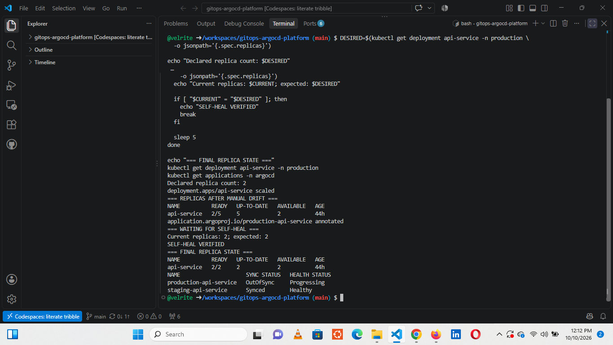
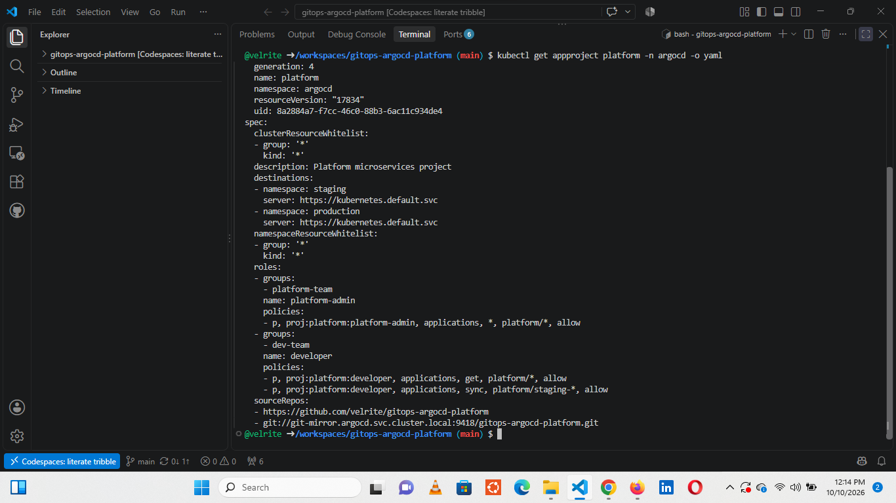

# GitOps ArgoCD Platform

Git is the only deployment interface. The cluster is a reflection of the repository.

**Status:** Argo CD (Helm chart 7.3.11) and Argo Rollouts are installed by Terraform on a local 3-node Minikube cluster (Kubernetes v1.31.0, profile `prod-sim`). Two environments, `staging` and `production`, are generated from one ApplicationSet and were Synced and Healthy when checked. A manual `kubectl scale` in production was reverted by self-heal before the next command returned. This is a local cluster, not a cloud deployment. Canary execution, Sloth SLO processing and Litmus experiment completion are defined but not verified at runtime. Every claim below carries a status, and the [claim table](#claim-status) shows how to re-check each one.

**Author:** Olamide Olalekan, Platform & DevSecOps Engineer | [GitHub](https://github.com/velrite) | [LinkedIn](https://linkedin.com/in/olamide-olalekan-12138a265) | velrite.tech@gmail.com

---

## In Plain Terms

When software is deployed by typing commands, the record of what is running lives in someone's terminal history. Here the record is a Git repository. Every change has an author, a timestamp and a diff. If someone changes the live system by hand, the platform notices and puts it back. If a release goes wrong, rolling back means reverting a commit.

---

## Engineering Problem

My earlier projects automated the platform but not the deployment. Someone still ran `terraform apply` or `kubectl apply`, and nothing stopped a manual change from creating state that existed nowhere in code.

This project sets the bar before any work started:

- both environments sync from Git with no human running a deploy command
- a manual change in the cluster is detected and reverted without intervention
- staging runs 1 replica and production runs 2, expressed as an overlay and not as a second copy of the app
- a developer role can sync staging but not production
- the admission layer rejects `:latest` images, pods without resource limits and privileged containers
- CI validates manifests and Terraform before anything can reach the cluster

---

## Headline Results

<p align="center">
  
</p>

| Result | What was shown |
| --- | --- |
| Self-healing delivery | A manual scale to 5 replicas in production was reverted to 2 before the next command returned |
| One template, two environments | A single ApplicationSet generated `staging` (1 replica) and `production` (2 replicas), both Synced and Healthy |
| The GitOps tool is itself code | Argo CD and Argo Rollouts installed from Terraform `helm_release` resources |
| Policy at the API server | Gatekeeper and Kyverno active: no `:latest`, resource limits required, privileged containers denied |
| Scoped access | AppProject limits deployment to one repository, two namespaces and two roles |
| Gated delivery | Four CI stages green: secret scan, manifest validation, Terraform validation, drift-check |

---

## Architecture

### Platform layout

```
Engineer ── pull request ──► GitHub repository (single source of truth)
                                  │                 ▲
              CI on every push    │                 │ read-only pull:
         (secrets, tfsec, dry-run,│                 │ 180s poll + cluster watch events
          drift-check)            ▼                 │
 ┌── Minikube cluster · profile prod-sim · 3 nodes · Kubernetes v1.31.0
 │
 │   namespace: argocd        installed by Terraform (helm_release, chart 7.3.11)
 │   ├── API server                 UI, CLI, RBAC enforcement
 │   ├── Repo server                clones the repo, renders Kustomize
 │   ├── Application controller     compares rendered Git vs live cluster, syncs, self-heals
 │   ├── ApplicationSet controller  matrix generator -> one Application per environment
 │   └── AppProject "platform"      1 allowed repo, 2 allowed namespaces, 2 roles
 │
 │   Application controller applies rendered manifests to:
 │   ├── namespace: staging        api-service (1 replica)
 │   └── namespace: production     api-service (2 replicas) + Rollout definition (canary)
 │
 │   Admission layer: every create or update request passes through it
 │   ├── OPA Gatekeeper     no-latest-tag
 │   └── Kyverno            require-resource-limits, disallow-privileged
 │
 │   Also installed: Argo Rollouts controller, Sloth SLO resource, Litmus ChaosEngine
 └──────────────────────────────────────────────────────────────────────────────────
```

### From commit to running pod

```
 1  Commit lands on main
 2  CI: secret scan + tfsec -> manifest dry-run + terraform validate -> drift-check
 3  Repo server fetches the commit (180s poll; no inbound webhook on a local cluster)
 4  Repo server renders apps/<env> with Kustomize
 5  Application controller diffs rendered output against live objects
 6  If different, it syncs in wave order: 0 Namespace, 1 ConfigMap/Service, 2 Deployment, 3 Rollout
 7  Each object passes admission (Gatekeeper, Kyverno) before it is stored
 8  Controller assesses health and reports Synced / Healthy
```

### Self-heal

```
kubectl scale deployment api-service -n production --replicas=5
        │
        ▼
 live: 5 replicas       Git: 2 replicas
        │
        ▼
 controller sees the change through its cluster watch (not the 180s Git poll)
        │
        ▼
 selfHeal: true -> sync applies the Git state
        │
        ▼
 live: 2 replicas       corrected before the next kubectl command returned
```

<p align="center">
  
</p>

The 5-replica state never lasted long enough to screenshot. The timestamps around the correction are the evidence.

### Admission path

```
request ─► authn ─► authz ─► mutating admission ─► schema validation ─► validating admission ─► stored
                                                                         │
                                         Gatekeeper: no-latest-tag ──────┤
                                         Kyverno: limits, privileged ────┘
```

CI catches mistakes before a push. Admission catches them at the API server, including for `kubectl` changes that never touched Git. Admission is only as strong as the webhook's `failurePolicy`; see [Security](#security).

### Components

| Component | Job | If it stops |
| --- | --- | --- |
| Application controller | Diff Git vs cluster, sync, self-heal | Cluster keeps running; drift is no longer corrected |
| Repo server | Clone repo, render Kustomize | No new syncs; last applied state stays |
| API server | UI, CLI, RBAC | Cannot log in; reconciliation continues |
| ApplicationSet controller | Generate Applications from the matrix | Existing Applications stay; new ones are not generated |
| Argo Rollouts controller | Run canary steps on `Rollout` objects | Rollout objects stop progressing |
| OPA Gatekeeper | Reject `:latest` images | Depends on webhook `failurePolicy` |
| Kyverno | Require limits, deny privileged | Depends on webhook `failurePolicy` |

### Namespaces

| Namespace | Holds |
| --- | --- |
| `argocd` | Argo CD components, AppProject, ApplicationSet |
| `argo-rollouts` | Argo Rollouts controller |
| `staging` | api-service, 1 replica |
| `production` | api-service, 2 replicas, Rollout definition |
| `gatekeeper-system` | OPA Gatekeeper |
| `security` | Kyverno |
| `chaos` | Litmus |

### Environments from one template

The ApplicationSet crosses an environment list with an app list. Each pair becomes an Application.

```yaml
generators:
  - matrix:
      generators:
        - list:
            elements:
              - { environment: staging,    namespace: staging,    repoPath: apps/staging }
              - { environment: production, namespace: production, repoPath: apps/production }
        - list:
            elements:
              - { app: api-service }
```

Result: `staging-api-service` and `production-api-service`. A new environment is one list entry. A new app is one list entry.

| | staging | production |
| --- | --- | --- |
| Replicas | 1 (Kustomize patch) | 2 (inherited from base) |
| Label | `environment: staging` | `environment: production` |
| Sync policy | automated, prune, selfHeal | automated, prune, selfHeal |
| Canary Rollout | no | defined, not executed |
| Developer role | may sync | read-only |

### Sync policy

| Field | Value | Effect |
| --- | --- | --- |
| `automated` | on | Git changes apply without a manual sync |
| `prune` | true | Objects removed from Git are removed from the cluster |
| `selfHeal` | true | Manual cluster changes are reverted |
| `CreateNamespace` | true | Target namespace is created if missing |
| `retry` | 5 attempts, 5s start, factor 2, 3m cap | Retries at 5s, 10s, 20s, 40s, 80s |

### Access model

AppProject `platform` allows one source repository and two destinations (`staging`, `production` on the local cluster). Nothing else can be deployed through it.

| Role | Group | Can |
| --- | --- | --- |
| `platform-admin` | `platform-team` | Everything in the project |
| `developer` | `dev-team` | View all applications, sync `staging-*` only |

The role definitions are visible in the cluster. Their behaviour has not been exercised with a non-admin login.

### Why the pull model matters

In push-based CD, the CI system holds cluster credentials. Compromise CI and the cluster is exposed. Here the cluster pulls from Git. CI holds no cluster credentials, and because the repository is public, Argo CD holds no Git credentials either. A compromised pipeline can push a bad commit, but that commit still goes through the same render, diff, admission and sync path.

---

## Claim Status

| Claim | Status | Re-check |
| --- | --- | --- |
| Argo CD and Argo Rollouts installed by Terraform | Verified | `terraform state list` · `kubectl get pods -n argocd` |
| One ApplicationSet generates two Applications | Verified | `kubectl get applications -n argocd` |
| `staging` and `production` Synced and Healthy | Verified | `argocd app list` |
| Staging 1 replica, production 2 | Verified | `kubectl get deploy api-service -n staging` |
| Self-heal reverts a manual scale | Verified, corrected before the next command returned | Scale to 5, then `kubectl get pods -n production` |
| AppProject roles defined | Verified, definition visible. Not tested with a non-admin login | `kubectl get appproject platform -n argocd -o yaml` |
| OPA `no-latest-tag` active | Constraint active, 0 violations. A rejected `:latest` deploy is not yet recorded | `kubectl get nolatesttag` |
| Kyverno policies ready | Both Ready. A rejected pod is not yet recorded | `kubectl get clusterpolicy` |
| Sync-wave annotations | Present in manifests. Ordered rollout across waves not observed | `grep -r sync-wave apps/` |
| CI: scan, validate, drift-check | Verified on a green run | Actions tab |
| Canary rollout (10 / 25 / 50 / 100) | Defined and applied. Not executed: needs an image I own to push | `kubectl get rollout -n production` |
| Sloth 99.9% SLO | Resource applied. Controller output not confirmed | `kubectl get prometheusservicelevel` |
| Litmus pod-delete experiment | Resource applied. Completion not confirmed | `kubectl get chaosengine` |

Every "not yet recorded" row is a short test, listed in [Next](#next).

---

## Evidence

<table>
  <tr>
    <td align="center"><br><sub>Drift correction</sub></td>
    <td align="center"><br><sub>AppProject roles</sub></td>
  </tr>
</table>

All captures are in [`docs/evidence/`](docs/evidence/). The bootstrap admin credential is never written to the repository or shown in a capture.

---

## Security

Three layers, each catching a different failure.

| Layer | Catches | Limit |
| --- | --- | --- |
| CI: TruffleHog, tfsec, manifest dry-run | Secrets, insecure Terraform, malformed YAML, before the push | Skippable by anyone who pushes around it |
| Gatekeeper | `:latest` image tags | Effective only while the webhook answers (`failurePolicy` not tuned) |
| Kyverno | Missing resource limits, privileged containers | Same webhook limit |

Base manifests set the security context, so it is the default and not an opt-in: `runAsNonRoot`, `allowPrivilegeEscalation: false`, all capabilities dropped, explicit requests and limits.

No credentials are stored in the repository. The Argo CD bootstrap secret is read locally at login and should be rotated and removed after first use on anything beyond a lab.

---

## Decisions

Full records in [docs/ADR.md](docs/ADR.md).

| Decision | Chosen | Over | Cost |
| --- | --- | --- | --- |
| Environment config | Kustomize overlays | Helm values per environment | Base file is copied into each overlay (see Incident 1) |
| Many environments | ApplicationSet matrix | One Application file per environment and app | Debugging needs the generator output |
| Sync | Automated with self-heal, both environments | Manual gate on production | No hotfixes by `kubectl`. A regulated team can remove `automated` on production |
| Policy | OPA and Kyverno together | Either alone | Two webhooks add admission latency |
| Bootstrap | Terraform `helm_release` | Manual `helm install` | Cluster must exist first |

---

## Incidents

Full write-ups in [docs/INCIDENTS.md](docs/INCIDENTS.md).

| # | What happened | Cause | Outcome |
| --- | --- | --- | --- |
| 1 | Both Applications showed `ComparisonError` right after the ApplicationSet was applied | The overlay listed `../base/deployment.yaml`, a file outside the overlay root. Kustomize's default load restrictor rejects that: `file is not in or below 'apps/staging'` | Worked around by copying the base into each overlay. The cleaner fix is to reference the base as a directory (`../base`), which is allowed. Not yet applied |
| 2 | The 5-replica drift could not be screenshotted | Self-heal corrected it first | Timing recorded as the evidence |
| 3 | `argocd` CLI: `connection refused` mid-session | The port-forward died when the Argo CD server pod restarted under memory pressure | Restarted the port-forward. Starting each session with a fresh one |

---

## Reliability

| Failure | Expected behaviour | Tested |
| --- | --- | --- |
| Manual scale in production | Reverted by self-heal | Yes |
| Kustomize render fails | `ComparisonError`, sync blocked, cluster unchanged | Yes (Incident 1) |
| Argo CD server pod restarts | Sync pauses, pod returns, port-forward drops | Yes (Incident 3) |
| Git repository unreachable | `RepoError`, last applied state stays | No |
| Admission webhook unreachable | Depends on `failurePolicy` | No |
| Bad commit merged | Syncs to the cluster. Recovery is `git revert` | No |

---

## CI Pipeline

```
push to main
   │
   ▼
security-scan ── TruffleHog (secrets) · tfsec (Terraform)
   │
   ├──► validate-manifests ── kubectl dry-run on apps/ argocd/ security/
   └──► validate-terraform ── fmt -check · init -backend=false · validate
              │
              ▼
          drift-check ── sync-wave, securityContext, limits, SLO and chaos files present
```

`drift-check` greps the repository for expected annotations and files. It does not touch the cluster, because the runner has no cluster access. It proves the repository is well-formed, not that the cluster is healthy.

---

## Repository Structure

```
gitops-argocd-platform/
├── terraform/
│   ├── main.tf                      Argo CD + Argo Rollouts helm_release, namespaces
│   └── argocd-values.yaml           RBAC policy, metrics, resource limits
├── apps/
│   ├── base/
│   │   ├── deployment.yaml          base manifest: security context, probes, limits
│   │   └── namespace.yaml           sync-wave "0"
│   ├── staging/
│   │   ├── deployment.yaml          copy of base
│   │   └── kustomization.yaml       patch: 1 replica, staging label
│   └── production/
│       ├── deployment.yaml          copy of base
│       ├── kustomization.yaml       production label
│       └── rollout.yaml             canary steps
├── argocd/
│   ├── projects/platform-project.yaml     AppProject, 2 roles
│   └── appsets/platform-appset.yaml       ApplicationSet, matrix generator
├── security/
│   ├── opa/no-latest-tag.yaml             ConstraintTemplate + constraint
│   └── kyverno/require-resources.yaml     require-resource-limits, disallow-privileged
├── observability/sloth/api-service-slo.yaml    99.9% availability SLO
├── chaos/litmus/pod-kill-experiment.yaml       pod-delete ChaosEngine
├── .github/workflows/gitops.yml     CI pipeline
├── docs/                            ARCHITECTURE, GITOPS_MODEL, SECURITY, ADR, INCIDENTS, GAPS, evidence/
└── README.md
```

---

## Quick Start

Needs a running Minikube cluster plus `kubectl`, `helm`, `terraform` and the `argocd` CLI.

```bash
# 1. Install Argo CD and Argo Rollouts
cd terraform/
terraform init
terraform apply

# 2. Reach the API server (re-run if the pod restarts)
kubectl port-forward svc/argocd-server -n argocd 8080:80 &
sleep 3

# 3. Log in without printing the bootstrap credential
argocd login localhost:8080 --username admin --insecure \
  --password "$(kubectl -n argocd get secret argocd-initial-admin-secret \
  -o jsonpath='{.data.password}' | base64 -d)"

# 4. Apply the project and the ApplicationSet
cd ..
kubectl apply -f argocd/projects/platform-project.yaml
kubectl apply -f argocd/appsets/platform-appset.yaml

# 5. Sync and check
argocd app sync staging-api-service --insecure
argocd app sync production-api-service --insecure
argocd app list
```

Reproduce the drift test:

```bash
date; kubectl scale deployment api-service -n production --replicas=5
sleep 10; date
kubectl get pods -n production | grep -c api-service      # expect 2
argocd app get production-api-service --insecure | grep -E "Sync Status|Health Status"
```

---

## What Is Not Done

| Gap | Why | Production answer |
| --- | --- | --- |
| Canary never executed | Needs a new image tag in a registry I own | Build a small service, push to a registry, trigger the 10 / 25 / 50 / 100 steps |
| Overlays duplicate the base | Workaround for Incident 1 | Reference `../base` as a directory |
| Role behaviour untested | No non-admin identity wired in | SSO or a scoped token, then try a production sync as `developer` |
| Single cluster | Local lab | Separate clusters per environment, registered in Argo CD |
| Admission webhooks use default failure handling | Not tuned | Set `failurePolicy` per webhook deliberately |
| No image signing or Image Updater | Out of scope | Cosign verification, Argo CD Image Updater |
| No External Secrets | Out of scope | External Secrets Operator with a real secret store |
| Sloth and Litmus unconfirmed | Resources applied, output not checked | Confirm generated rules in Prometheus and experiment results |

Detail in [docs/GAPS.md](docs/GAPS.md).

---

## Next

These close the "not yet recorded" rows above:

1. Apply a `:latest` Deployment and a pod with no limits, and record both rejections.
2. Repeat the drift test several times and record the timings in a table.
3. Switch the overlays to `../base`, remove the copied files, and confirm both Applications stay Synced.
4. Build a small image I own and run the canary end to end.

---

## Documentation

| File | Contents |
| --- | --- |
| [ARCHITECTURE.md](docs/ARCHITECTURE.md) | GitOps flow, component roles, overlays, sync waves |
| [GITOPS_MODEL.md](docs/GITOPS_MODEL.md) | How sync works, self-heal, rollback, ApplicationSet |
| [SECURITY.md](docs/SECURITY.md) | AppProject limits, OPA, Kyverno |
| [ADR.md](docs/ADR.md) | Decision records |
| [INCIDENTS.md](docs/INCIDENTS.md) | ComparisonError, drift too fast to screenshot, lost port-forward |
| [GAPS.md](docs/GAPS.md) | What is defined but not proven |

---
## What This Demonstrates

For a team adopting Argo CD, or tightening an existing GitOps setup, this repository shows:

- **The whole loop, not just an install.** Bootstrap from Terraform, define the project and ApplicationSet, sync two environments, break one on purpose, watch it recover.
- **Policy as code at admission.** Two engines, each used where it fits: Rego for Gatekeeper, YAML patterns for Kyverno. The trade-off is written down in the ADRs.
- **Audit by construction.** Every cluster change traces to a commit, an author and a timestamp. Rollback is `git revert`.
- **Evidence discipline.** The claim table separates what was defined from what was observed, and every row has a command a reviewer can run.
- **Root-cause thinking.** Incident 1 was traced to Kustomize's load restrictor, and the first workaround is recorded next to the cleaner fix.
- **Security reasoning.** The pull model removes cluster credentials from CI, and the layered controls each state what they do not cover.

---

## Related Projects

- [Auto-Healing Kubernetes Platform](https://github.com/velrite/auto-healing-k8s--): the platform this one deploys onto
- [Terraform Kubernetes Platform](https://github.com/velrite/Terraform-Kubernetes-Platform): the IaC pattern used here to install Argo CD
- [Atlas](https://github.com/velrite/atlas) and [Forge](https://github.com/velrite/forge): GitOps on real GKE clusters
